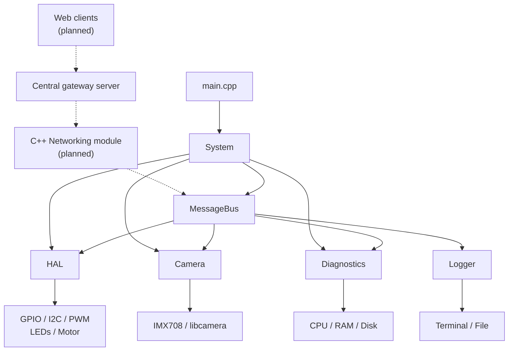
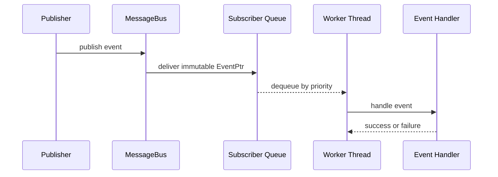

# Embedded Vehicle Stack


A modular, event-driven C++23 control stack for a Raspberry Pi-based robotic vehicle.

The long-term goal is to build a fully functional smart RC vehicle with a custom 3D-printed chassis, motorized propulsion, servo steering, an onboard camera, and continuous system telemetry. The vehicle will be controlled remotely from a web application through a central gateway server, while the C++ stack running on the Raspberry Pi translates network commands into internal events and hardware actions. The final system is planned to support live video, remote driving, diagnostics monitoring, controlled shutdown, and access from multiple web clients.

The project coordinates hardware access, motor control, camera capture, system diagnostics, and logging through an asynchronous event-driven architecture. It is designed as a practical embedded and systems programming project, with a focus on concurrency, hardware abstraction, explicit subsystem lifecycle management, observability, and safe failure handling.

The current milestone has been built and tested on physical Raspberry Pi hardware, including real motor control, diagnostic LEDs, and camera capture.

> **Project status:** Hardware-tested development prototype.  
> The current application entry point runs a deterministic motor bring-up sequence and is not yet the final production entry point.

## Engineering Highlights

- Modular subsystem architecture with centralized startup and shutdown coordination.
- Asynchronous, priority-based event routing through a central `MessageBus`.
- Independent event queues and worker threads for event-processing modules.
- Immutable shared events with typed payloads, unique IDs, timestamps, priorities, and source metadata.
- End-to-end event tracing across `PUBLISHED`, `RECEIVED`, `HANDLED`, and `FAILED` stages.
- Startup rollback and graceful shutdown when a subsystem cannot be started safely.
- Hardware abstraction for GPIO, I2C, PWM, LEDs, and motor control.
- Physical DC motor control through a PCA9685 PWM controller and BTS7960 motor driver.
- Camera preview and JPEG snapshot capture using `libcamera` and TurboJPEG.
- Periodic CPU, RAM, and disk diagnostics with event-based health reporting.
- Thread-safe multi-sink logging with terminal and file output support.
- Architecture prepared for a future networking module and remote vehicle control.

## System Architecture

The application is divided into independent subsystems coordinated by `System`. Runtime communication is handled asynchronously through the `MessageBus`, which keeps modules decoupled from one another.



### Core Responsibilities

- **`System`** owns the central `MessageBus` and coordinates subsystem startup, rollback, and shutdown.
- **`MessageBus`** asynchronously routes immutable events to interested subscribers.
- **`EventProcessor`** gives participating modules a local priority queue, worker thread, and event handlers.
- **`HAL`** owns hardware-facing abstractions and translates control events into physical actions.
- **`Camera`** manages preview frames and JPEG snapshot capture through `libcamera`.
- **`Diagnostics`** periodically monitors CPU, RAM, and disk usage and publishes health events.
- **`Logger`** receives application and diagnostic information and writes it to configured sinks.
- **`Networking`** will connect the embedded stack to the central gateway and translate remote commands into internal events.

## Event-Driven Communication

Subsystems do not call one another directly. Instead, they exchange typed events through the central `MessageBus`, allowing each module to evolve independently.



### Event Flow

1. A publisher creates an `Event` with a type, payload, and priority.
2. `EventProcessor::publish()` assigns the publisher name as the event source.
3. The event is converted into an immutable shared `EventPtr`.
4. `MessageBus` places the event into its priority queue.
5. The bus forwards the same event instance to all registered subscribers.
6. Each subscriber stores it in its own local priority queue.
7. The subscriber's worker thread invokes the handlers registered for that event type.
8. Event tracing records the event's progress through the system.

Events with lower priority values are processed first. Events with the same priority retain their creation order through their unique IDs.

### Event Structure

| Field | Purpose |
|---|---|
| `id` | Globally unique event identifier |
| `type` | Defines the event category and expected behavior |
| `payload` | Typed data stored in `std::variant` |
| `priority` | Processing priority; lower values are more important |
| `createdAtMs` | Event creation timestamp |
| `source` | Name of the originating module |

Published events are shared as `std::shared_ptr<const Event>`. Subscribers can read an event but cannot modify it, preventing one receiver from changing the data observed by another.

## Event Tracing

Every event can be followed across the complete asynchronous processing path by using its unique ID.

```text
[EVENT_TRACE] stage=PUBLISHED event_id=12 event_type=MOTOR_DRIVE source=MotorBringUp priority=10
[EVENT_TRACE] stage=RECEIVED event_id=12 event_type=MOTOR_DRIVE source=MotorBringUp receiver=HAL priority=10
[EVENT_TRACE] stage=HANDLED event_id=12 event_type=MOTOR_DRIVE source=MotorBringUp receiver=HAL handler_count=1
```

The trace stages are:

- **`PUBLISHED`** — the event was accepted by the running `MessageBus`;
- **`RECEIVED`** — the event was delivered to a subscriber's local queue;
- **`HANDLED`** — all registered handlers completed successfully;
- **`FAILED`** — no handler was found or a handler threw an exception.

Tracing is controlled centrally through `EventTrace` and can be disabled when detailed runtime logging is not required.

During shutdown, an `EventProcessor` stops accepting new events, processes the events already present in its queue, and then joins its worker thread.

## Implemented Subsystems

| Component | Responsibility | Status |
|---|---|---|
| `System` | Subsystem ownership, startup, rollback, and shutdown | Implemented |
| `MessageBus` | Asynchronous priority-based event routing | Implemented |
| `EventProcessor` | Local event queues, worker threads, and handlers | Implemented |
| `HAL` | Hardware ownership and control-event processing | Implemented |
| `Motor` | Direction, PWM speed control, and safe stopping | Left motor hardware-tested |
| `Camera` | Preview frame acquisition and JPEG snapshots | Implemented |
| `Diagnostics` | CPU, RAM, and disk monitoring | Implemented |
| `Logger` | Thread-safe terminal and file logging | Implemented |
| `Networking` | Communication with the central gateway | Planned |

### Hardware Abstraction Layer

The HAL separates application logic from low-level hardware operations.

Its current structure includes:

- GPIO chip and pin ownership through `GpioManager`;
- digital input and output pin abstractions;
- Linux I2C communication through `I2CBus` and `I2CDevice`;
- PCA9685 PWM generation through `PCADriver`;
- diagnostic LED devices;
- motor and motor-driver abstractions;
- event handlers for motor commands and diagnostic updates.

A `MOTOR_DRIVE` event contains the target motor, direction, and duty cycle. A `MOTOR_STOP` event safely disables the selected motor.

### Camera

The camera subsystem uses `libcamera` and supports:

- camera discovery and initialization;
- preview stream configuration;
- frame-buffer allocation and memory mapping;
- non-owning frame views for preview processing;
- owned frame copies for snapshots;
- JPEG encoding through TurboJPEG;
- snapshot storage on disk;
- camera state transitions and error callbacks.

Recording-related event types already exist, but full recording functionality is not yet implemented.

### Diagnostics

The diagnostics subsystem periodically collects:

- CPU usage;
- RAM usage;
- disk usage;
- overall system health.

Diagnostic snapshots, warnings, and alerts are published as events. The HAL uses these updates to select the appropriate green, yellow, or red diagnostic LED.

### Logging

The logger supports multiple output sinks through a shared interface.

Currently available sinks:

- colored terminal output;
- file output.

Sink management is protected by a mutex because logging can be triggered concurrently by subsystem workers, event processors, and the main application thread. The current policy broadcasts every log entry to all configured sinks; selective sink policies are planned for remote logging.

## Hardware Platform

| Component | Purpose |
|---|---|
| Raspberry Pi 4B | Main onboard computer |
| Raspberry Pi IMX708 camera | Preview, snapshots, and future live video |
| PCA9685 | External PWM generation over I2C |
| BTS7960 motor drivers | High-current DC motor control |
| DC geared motors | Vehicle propulsion |
| Diagnostic LEDs | Visual system-health indication |
| 3S Li-ion battery with BMS | Motor-side power source |
| Voltage step-down converter | Regulated Raspberry Pi power |
| Steering servo | Planned steering control |
| Hall encoders | Planned motion feedback |

The current software milestone controls and tests the left propulsion motor. Support for the second motor, steering servo, and encoder feedback will be completed in later milestones.

## Software Stack

| Technology | Usage |
|---|---|
| C++23 | Main embedded application |
| CMake | Project configuration and build |
| Linux / Raspberry Pi OS | Target operating system |
| `std::jthread` | Managed worker threads |
| Atomics, mutexes, and condition variables | Thread synchronization |
| `std::variant` | Typed event payloads |
| `std::shared_ptr<const Event>` | Shared immutable events |
| libgpiod | GPIO access |
| Linux I2C interface | PCA9685 communication |
| libcamera | Camera capture pipeline |
| TurboJPEG | JPEG snapshot encoding |

## Lifecycle and Failure Handling

The application follows an explicit lifecycle:

1. `System` creates the `MessageBus` and subsystem objects.
2. The message bus starts before event-producing subsystems.
3. Subsystems start in the order `HAL`, `Diagnostics`, and `Camera`.
4. Event-processing subsystems start their local event loops before subscribing to bus events.
5. If startup fails, already-started modules are stopped in reverse order.
6. Normal shutdown stops `Camera`, `Diagnostics`, and `HAL`, followed by the `MessageBus`.

Additional safeguards include:

- rejecting events when an `EventProcessor` is no longer accepting work;
- draining queued events before an event worker exits;
- unsubscribing processors before their destruction;
- joining worker threads during shutdown;
- placing motor-control pins into a safe state;
- releasing camera buffers, PWM resources, GPIO lines, and I2C handles;
- reporting startup and handler failures through the logger.

## Repository Structure

```text
embedded-vehicle-stack/
├── CMakeLists.txt
├── README.md
└── src/
    ├── main.cpp
    ├── core/
    │   ├── Camera/
    │   │   ├── Camera
    │   │   └── CameraBackend
    │   ├── Diagnostics/
    │   │   └── Monitors/
    │   ├── Event/
    │   │   ├── Event
    │   │   ├── EventProcessor
    │   │   └── EventTrace
    │   ├── HAL/
    │   │   ├── Devices/
    │   │   │   ├── LED/
    │   │   │   └── Motor/
    │   │   ├── I2C/
    │   │   ├── Pins/
    │   │   └── PWM/
    │   ├── MessageBus/
    │   └── System/
    └── utils/
        ├── enums/
        └── logger/
```

## Development and Hardware Validation

This project is developed for a specific Raspberry Pi vehicle configuration and is not currently intended to be executed as a general-purpose application on unrelated hardware.

The current milestone has been validated through controlled hardware bring-up tests covering:

- complete subsystem startup and shutdown;
- event publication, delivery, handling, and tracing;
- left motor direction and PWM duty-cycle control;
- safe motor stops between direction changes;
- diagnostic LED updates;
- CPU, RAM, and disk monitoring;
- camera initialization, preview frames, and JPEG snapshots.

The current `main.cpp` is a temporary hardware-integration test. It will later be replaced by a minimal application entry point that starts the system and waits for commands from the networking subsystem.

## Current Project Status

### Implemented

- [x] System and subsystem lifecycle
- [x] Startup rollback logic
- [x] Asynchronous `MessageBus`
- [x] Per-subscriber event queues
- [x] Priority-based event processing
- [x] End-to-end event tracing
- [x] Thread-safe multi-sink logging
- [x] GPIO and digital output abstractions
- [x] Linux I2C communication
- [x] PCA9685 PWM control
- [x] Left motor direction and speed control
- [x] Diagnostic LEDs
- [x] CPU, RAM, and disk monitoring
- [x] Camera preview pipeline
- [x] JPEG snapshot capture

### Hardware-Validated

- [x] Raspberry Pi subsystem startup and shutdown
- [x] PCA9685 communication over I2C
- [x] BTS7960 motor-driver control
- [x] Forward and backward motor movement
- [x] Multiple PWM duty cycles
- [x] Safe stops between direction changes
- [x] Diagnostic LED health indication
- [x] IMX708 preview and snapshot capture
- [x] Complete event-tracing path during motor commands

### Partially Implemented

- [ ] Final application entry point and runtime loop
- [ ] Complete two-motor vehicle control
- [ ] Camera recording mode
- [ ] Selective log routing between sinks
- [ ] Centralized event contracts and payload validation

### Planned

- [ ] C++ networking subsystem
- [ ] Connection to the central gateway
- [ ] Translation of remote commands into internal events
- [ ] Vehicle telemetry publishing
- [ ] Networking-triggered controlled shutdown
- [ ] Remote diagnostic and selected log delivery
- [ ] Steering-servo control
- [ ] Encoder-based motor feedback
- [ ] Live video transport
- [ ] Automated tests and continuous integration
- [ ] Simulation mode for development without physical hardware

## Roadmap

The next development milestones are:

1. Replace the motor bring-up `main.cpp` with a clean application entry point.
2. Finalize event contracts used at module boundaries.
3. Implement the C++ networking subsystem.
4. Connect the vehicle to the existing central gateway.
5. Translate authenticated remote commands into internal control events.
6. Publish telemetry and selected diagnostic data to web clients.
7. Add controlled shutdown initiated by a networking command.
8. Integrate steering, the second motor, and encoder feedback.
9. Introduce automated tests, simulation support, and CI.
10. Add low-latency live video transport.

## Companion Project: Vehicle Network Gateway

[vehicle-network-gateway](https://github.com/kelecevic10/vehicle-network-gateway) is the central communication layer between one physical vehicle and multiple web clients.

The gateway is implemented as a separate Node.js and TypeScript project. Its current responsibilities include:

- vehicle and web-client authentication;
- WebSocket connection management;
- control-command validation and forwarding;
- vehicle telemetry broadcasting;
- heartbeat monitoring;
- dead-connection detection;
- communication protocol definitions;
- fake vehicle and client applications for integration testing.

The planned C++ networking subsystem will maintain the vehicle-side gateway connection. Incoming remote-control messages will be translated into internal events, while telemetry, diagnostics, and selected logs will be sent in the opposite direction.

The complete communication path will be:

```text
Web client
    -> vehicle-network-gateway
        -> C++ Networking subsystem
            -> MessageBus
                -> HAL / Camera / System

Vehicle telemetry
    -> C++ Networking subsystem
        -> vehicle-network-gateway
            -> connected web clients
```

## Author

Developed by [Nemanja Kelecevic](https://github.com/kelecevic10).